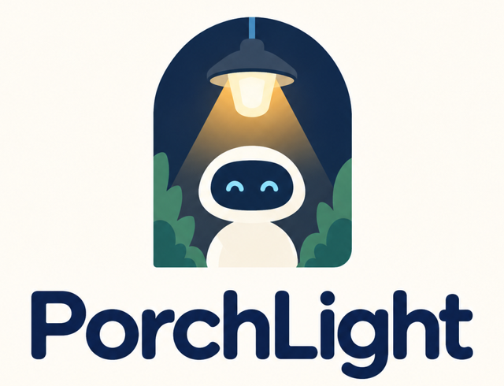

<p align="center"></p>

# PorchLight

**Drop a pin. PorchLight finds who fixes it.**

PorchLight is the first, narrow slice of the Altruistic Agent vision: a personal agent that makes a whole neighborhood smarter.

Drop a pin about something in your neighborhood. Your agent figures out who can fix it, drafts the report, puts it on a shared community map, tells your neighbors, and keeps you updated. Every morning it briefs you on your blocks.

Built for the Cline x Composio x Parallel hackathon, Monday October 19 2026. Demo city is San Francisco.

One person reporting a broken streetlight helps one block. The same work, made shareable, helps a neighborhood. PorchLight does the boring part: figuring out which of a dozen city departments owns the problem, finding the real reporting channel, writing the report, and keeping everyone posted.

---

## What it does

**Loop 1, pin it.** You click the map and write one line. The agent then:

1. triages the note with TypeSafe Jev: emergency probability and category, in about 100ms
2. uses Parallel Search to find the responsible agency and the correct reporting channel, with citations
3. checks with Parallel whether the issue is already known
4. has an open-weight model (gpt-oss-20b) turn those citations into a routing card, and refuses to name an agency no citation supports
5. writes the pin to the shared community ledger, a Google Sheet, via Composio
6. drafts a report email to the agency via Composio Gmail, and never sends it
7. posts the pin to the neighborhood Slack channel via Composio
8. watches Gmail through Composio for the agency's reply to the `[PIN-<id>]` thread, and Jev reads it: `acknowledged`, `resolved`, or `needs_human`

A Parallel Monitor step is wired (`app/research.py`, `/webhooks/parallel`) but cut from the live demo, see [docs/DECISION_monitor.md](docs/DECISION_monitor.md).

**Loop 2, morning brief.** A digest of pins near you, status changes on your issues, and civic dates, posted to Slack via Composio.

---

## Architecture

A deterministic pipeline with LLM steps inside it, not a free roaming agent loop. Same order every run, every step timed, every external call wrapped in a timeout and a fallback.

```
browser: Leaflet + OpenStreetMap, polls GET /pins every 3s
   |
   v  POST /pins  (returns immediately, pipeline runs in the background)
+---------------------------------------------------------------+
| 0 guardrail   emergency check            local rules           |
| 0 triage      emergency p + category     TYPESAFE Jev          |
| 1 geocode     coarse address hint        offline table         |
| 2 research    responsible agency + URL   PARALLEL Search       |
| 3 dedupe      is this already known      PARALLEL Search       |
| 4 route       routing card as JSON       OPEN MODEL + Pydantic |
| 5 verify      no source, no claim        local guardrails      |
| 6 ledger      append pin row             COMPOSIO Sheets       |
| 7 draft       report email, never sent   COMPOSIO Gmail        |
| 8 notify      post to the neighborhood   COMPOSIO Slack        |
| 9 watch       keep watching (cut, wired) PARALLEL Monitor      |
+---------------------------------------------------------------+
   |                         |                          |
   v                         v                          v
data/pins.json       Google Sheet mirror         Slack channel
(source of truth)    (best effort)               (+ Gmail draft)

later, asynchronously:
  agency replies  -> COMPOSIO Gmail poller  -> match [PIN-<id>]
                     TYPESAFE Jev reads the reply:
                       "request opened"      -> acknowledged
                       "lamp replaced, done" -> resolved
                       "need more info"      -> needs_human
                     -> notify on Slack
  new web signal  -> PARALLEL Monitor       -> POST /webhooks/parallel
                     attach an update to the pin
```

The Gmail path is a poller (`app/reply_poller.py`, `GMAIL_FETCH_EMAILS` every 8 seconds) rather than
the Composio trigger. Our Composio key is a consumer key, which has no trigger API, and Gmail
triggers poll upstream with minutes of lag anyway. `POST /webhooks/composio` is still wired and
tested with synthetic payloads for setups that use a project key and a trigger.

`data/pins.json` is the source of truth so the map always works. The Google Sheet is a mirror. If the Sheet write fails we log it and continue.

---

## Sponsor tech, and where it is load bearing

| Sponsor | Where | Why it matters |
|---|---|---|
| **Parallel** | `app/research.py`. `client.search(objective, search_queries)` for the agency lookup and the duplicate check. `client.monitor.create(type="event_stream")` for the ongoing watch, delivered to `/webhooks/parallel`. | This is what makes routing trustworthy. Without cited search results the agent refuses to name an agency. |
| **Composio** | `app/actions.py`. Gmail draft, Google Sheets append, Slack post, all by verified tool slug. `app/reply_poller.py` watches Gmail for agency replies. With a consumer key (`ck_...`) every call goes through Composio's MCP server (`connect.composio.dev/mcp`) as `COMPOSIO_MULTI_EXECUTE_TOOL` with one fixed slug; a project key uses the Python SDK. | This is the agent's hands. The pin becomes a real row, a real draft, and a real message in your neighbors' Slack. |
| **Open source model** | `app/llm.py`. OpenAI's open-weight **gpt-oss-20b** on NVIDIA's OpenAI-compatible endpoint, set with `NVIDIA_API_KEY`. Any other OpenAI-compatible provider works via `LLM_BASE_URL`. JSON out, validated by Pydantic, one retry, then a rule based classifier. | The fuzzy part only: classify, summarize, write the draft. It is never allowed to invent an agency or a URL. |
| **TypeSafe Jev** | `app/jev.py`. Typed decisions with calibrated confidence, about 100 to 300ms each, in three places: emergency triage, category triage before the Parallel search, and reading what an agency reply actually means. | Decisions, not prose. Confidence is a number we can threshold on, so a low confidence answer falls back to rules instead of guessing. |
| **Cline** | The whole build. | Pivoted the repo from an earlier idea and shipped this in one afternoon. |

**On the open-weight model choice:** gpt-oss-20b was picked after Gemma 4, DeepSeek and GLM
all timed out past 60 seconds and Nemotron came in slower. With `reasoning_effort: low` and a
tightened prompt, routing lands in 5 to 10 seconds, tested live on streetlight, pothole,
graffiti and tree reports.

**On Jev and the emergency guardrail:** a pin is treated as an emergency if the keyword rules
**or** Jev say so. Jev can only ever make that check more cautious, never less. If Jev is
unavailable or slow, the keyword rules stand on their own and the pipeline continues.

Tool slugs are never chosen by a model. The pipeline executes `GMAIL_CREATE_EMAIL_DRAFT`, `GOOGLESHEETS_SPREADSHEETS_VALUES_APPEND`, `SLACK_SEND_MESSAGE` and `GMAIL_FETCH_EMAILS` directly, against schemas verified on 2026-10-19.

---

## Guardrails

These are enforced in code, in `app/guardrails.py`, not just in a prompt.

- **No source, no claim.** If `agency` or `channel_url` is not backed by a citation Parallel actually returned, the pin becomes `needs_human` and the UI says "Couldn't verify the right agency" instead of guessing. Citations the model invents are dropped before validation.
- **Draft, never send.** The agent creates Gmail drafts. It has no send capability in this pipeline and it never submits a real 311 report. A human clicks send.
- **Emergencies are not routed.** Fire, gas leak, injury, crime in progress and similar notes skip the pipeline entirely and show "Call 911 now."
- **Privacy.** Only the note, the coordinates and a reporter display name are stored. Emails, phone numbers, ID numbers and apartment numbers are stripped from the note before anything is written or shared.
- **Civic neutrality.** Election content is dates and logistics only, from official sources. The agent never recommends a candidate or a position.

---

## Reliability

Built for a live demo on venue wifi.

- Every Composio, Parallel and LLM call has a timeout, 15s, 15s and 30s, plus a fallback.
- Every Parallel and LLM response is cached in `data/cache/`, keyed by a hash of the input.
- `DEMO_MODE=1` serves the cache first, so the demo is fast and identical every run. The cache is committed, so a fresh clone with no API keys still shows a fully cited routing card.
- The map renders and accepts pins even if every external service is down. Failures show up as a red row in the agent trace, not an error page.
- Every step is logged with timings and exposed in the UI as an **agent trace**: step, tool, ms, ok.

---

## Setup

Requires Python 3.11 or newer.

```bash
git clone https://github.com/sykosyber/composio-hackathon
cd composio-hackathon
python3 -m venv .venv
.venv/bin/pip install -r requirements.txt

cp .env.example .env                    # works with no keys at all, in DEMO_MODE
.venv/bin/python scripts/seed.py        # 9 seeded SF pins
.venv/bin/python scripts/warm_cache.py  # pre-warm the demo cache
.venv/bin/python -m uvicorn app.main:app --port 8000
# open http://localhost:8000
```

To connect real accounts, put your keys in `.env` and run:

```bash
.venv/bin/python scripts/connect.py       # OAuth Gmail, Google Sheets, Slack
.venv/bin/python scripts/connect.py --trigger https://<tunnel>/webhooks/composio
```

Verify everything with the smoke suite, which needs no keys:

```bash
.venv/bin/python scripts/smoke.py         # 32 checks
```

## API

| Method | Path | Does |
|---|---|---|
| GET | `/pins` | all pins |
| POST | `/pins` | create a pin, run the pipeline in the background, return immediately |
| GET | `/pins/{id}` | one pin with its routing card and agent trace |
| GET | `/brief` | morning brief as JSON and markdown |
| POST | `/brief/send` | post the brief to Slack |
| POST | `/webhooks/composio` | Gmail trigger (project-key setups), matches `[PIN-<id>]`, Jev sets the status |
| POST | `/webhooks/parallel` | Monitor events, attached to the matching pin |
| POST | `/demo/reset` | restore seeded data |
| POST | `/demo/simulate_reply/{id}` | stage safe stand in for a real agency reply |

## Pin schema

`id, created_at, updated_at, lat, lng, address_hint, note, category, severity, agency, channel, channel_url, already_reported, status, sources, draft_id, slack_ts`

These are also the Google Sheet columns, in this order.

- `category`: `streetlight, road_pothole, sidewalk_accessibility, graffiti, illegal_dumping, tree, transit_stop, water_sewer, noise, parking, other`
- `severity`: `low | medium | high`
- `status`: `routing | routed | reported | acknowledged | resolved | needs_human`

## Repo layout

```
app/        config, models, store, cache, trace, geo, guardrails,
            llm, research (Parallel), actions (Composio), jev (TypeSafe),
            reply_poller (Gmail via Composio), pipeline, main (FastAPI)
web/        index.html, app.js, app.css   one static page, Leaflet, no build step
scripts/    seed.py, warm_cache.py, connect.py, smoke.py
data/       pins.json (source of truth), pins.seed.json, cache/
legacy/     an earlier ballot explainer idea, kept for history, not part of this product
```

## License

MIT, see [LICENSE](LICENSE).
